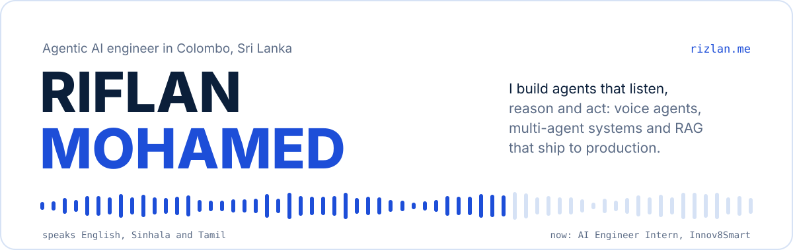
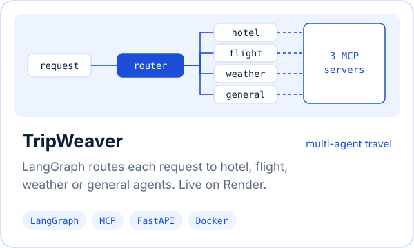
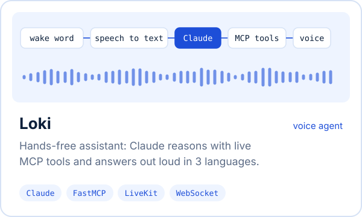
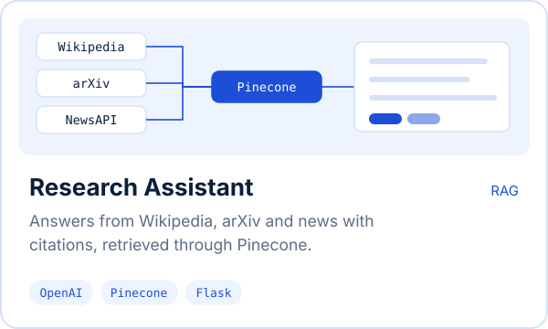
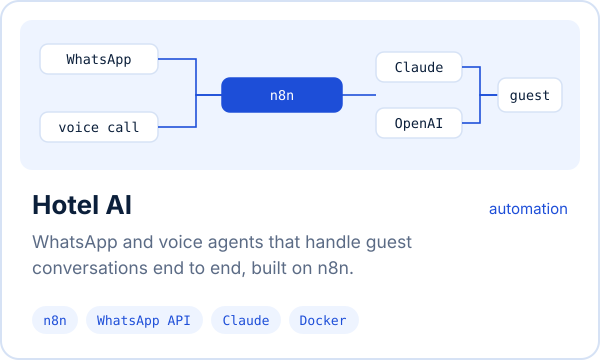
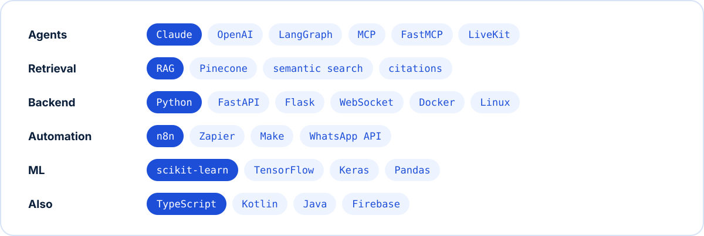

  
  
  

### Selected work

  
  
  
  

### Stack

DataCamp AI Engineer for Developers Associate, Oracle OCI AI Foundations, Anthropic Claude Code 101. BSc (Hons) Software Engineering, Birmingham City University. More projects at <a href="https://rizlan.me">rizlan.me</a>.
